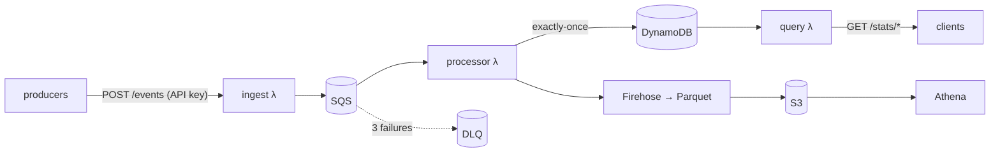

# eventstream

A serverless game telemetry pipeline on AWS, built with CDK v2 and TypeScript. Game clients
send player and match events to an HTTPS API. The events are validated, buffered in SQS,
aggregated **exactly once** into DynamoDB for a stats API, archived to S3 as Parquet for SQL in
Athena, and monitored with a CloudWatch dashboard and alarms. It costs about $0.05/month idle
and an estimated $2.70–$4.90 per million events, with quotas that cap what a leaked key can
spend.



The full diagram, delivery guarantees and request lifecycle are in
[docs/architecture.md](docs/architecture.md).

## Highlights

- **Per-event validation** with one zod schema shared by the API, the processor and the load
  generator. A bad event is rejected with a precise reason, and the rest of its batch still
  goes through.
- **Exactly-once aggregates on at-least-once SQS.** A conditional dedupe marker and the
  counter updates commit in one DynamoDB transaction. A simulation test delivers every event
  twice, shuffled, and checks the totals are identical.
- **Partial batch failures.** Only failing messages are retried. After 3 failures a message
  goes to the DLQ, which triggers an alarm.
- **Cheap analytics.** Firehose converts to Parquet, partition projection removes the need for
  crawlers, and the Athena workgroup has a 1 GB scan cap and five saved queries.
- **Cost-aware.** Each player's events in a batch share one DynamoDB transaction, the alarms
  stay inside the free tier, and per-key quotas bound the worst case. See
  [docs/cost-and-load.md](docs/cost-and-load.md).
- **Least privilege throughout.** Each Lambda can perform exactly the actions it needs, and
  tests pin the IAM action lists. Producers and readers use separate APIs and keys. See
  [docs/security.md](docs/security.md).
- **No stored AWS keys.** CI deploys through GitHub OIDC to a role that can only assume the CDK
  bootstrap roles.
- **Over 200 tests**: handler logic, CDK assertions, workflow security properties, and the
  idempotency simulation.

## Quick start

Requires Node.js 22.13 or later.

```bash
npm ci
npm run check          # typecheck, lint, format check, tests, cdk synth
npm run loadgen -- --dry-run --count 3   # see what events look like
```

| Script                      | What it does                                                |
| --------------------------- | ----------------------------------------------------------- |
| `npm test`                  | Jest: handler logic, CDK assertions, workflows              |
| `npm run lint` / `format`   | ESLint (type-aware) / Prettier                              |
| `npm run typecheck`         | `tsc --noEmit`, strict mode                                 |
| `npm run synth`             | `cdk synth` (bundles the Lambdas with esbuild)              |
| `npm run loadgen -- --help` | Load generator: seeded players, target rate, latency report |
| `npm run stack-info`        | Prints the deployed API URLs and keys as env vars           |
| `npm run check`             | Everything CI runs                                          |

## Deploying

Nothing deploys automatically until you set it up.

1. [docs/setup-aws.md](docs/setup-aws.md): AWS CLI sign-in with SSO, `cdk bootstrap`, deploy
   the **$5 budget alert first**, then the pipeline.
2. [docs/demo.md](docs/demo.md): send load, query stats, prove idempotency, query Athena.
3. [docs/setup-cicd.md](docs/setup-cicd.md): optional GitHub Actions deploys through OIDC.

## API

Two APIs, each with its own key. The producer key ships inside game clients, so it can only
send events, never read stats.

| API    | Request                              | Response                                                                         |
| ------ | ------------------------------------ | -------------------------------------------------------------------------------- |
| ingest | `POST /events` `{"events":[…1-100]}` | `202 {"accepted", "rejected":[{index, issues}], "failed":[…]}`; `413` over 1 MiB |
| stats  | `GET /stats/players/{playerId}`      | Player totals, `win_rate`, `kd_ratio`, revenue per currency                      |
| stats  | `GET /stats/daily/{YYYY-MM-DD}`      | Event counts per type, play time, revenue                                        |
| stats  | `GET /stats/daily?from=…&to=…`       | Up to 31 days, zero-filled                                                       |

Every request needs `x-api-key`. Each key has a rate limit and a daily quota.

## Event model

```
event_id        uuid, used for idempotency
event_type      session_start | session_end | match_start | match_end | purchase | level_up
schema_version  integer (currently 2)
player_id       string
occurred_at     ISO-8601 timestamp from the client
payload         typed per event_type (packages/schema/src/payloads.ts)
```

## Documentation

| Doc                                       | Contents                                                          |
| ----------------------------------------- | ----------------------------------------------------------------- |
| [architecture.md](docs/architecture.md)   | Diagram, lifecycle, guarantees, layout                            |
| [cost-and-load.md](docs/cost-and-load.md) | Cost model, throughput limits, load-test plan                     |
| [milestones/](docs/milestones)            | One doc per milestone, each with design choices and interview Q&A |

## Roadmap

All milestones (0 to 8) are complete as code. The load-test and cost tables in
[cost-and-load.md](docs/cost-and-load.md) are filled in after a deployed test run.
