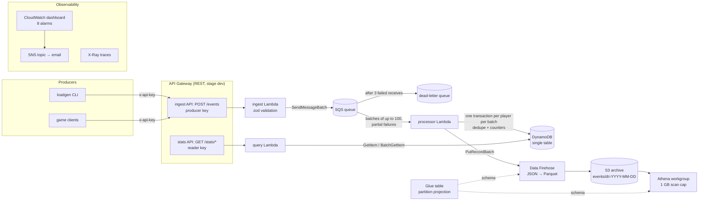

# Architecture



## Request lifecycle

1. **Ingest.** A producer posts 1 to 100 events. API Gateway rejects a missing or wrong key
   (403) or an over-limit key (429). The ingest Lambda validates each event with the shared
   zod schema, wraps the valid ones as `{received_at, event}`, and sends them to SQS 10 at a
   time. It answers 202 with per-event `rejected` and `failed` lists.
2. **Buffer.** SQS keeps messages for up to 4 days. The visibility timeout is 180 s (6× the
   processor timeout). After 3 failed receives, a message moves to the DLQ, where it's kept for
   14 days.
3. **Process.** Lambda polls in batches of up to 100, waiting up to 10 s to fill a batch, with
   at most 5 concurrent invocations. Each player's events in the batch are applied in one
   DynamoDB transaction: a dedupe marker per event plus the summed player and day counters, so
   each event is counted exactly once. Then they're sent to Firehose. Failed messages are reported individually and retried alone.
4. **Serve.** The query Lambda does point reads by key. Responses are cached for 10 s.
5. **Archive.** Firehose buffers for 5 minutes or 64 MiB, converts the data to Parquet using
   the Glue schema, and writes daily partitions. Athena queries them directly, de-duplicating
   by `event_id`.
6. **Observe.** Every Lambda logs JSON, emits EMF metrics, and traces SDK calls to X-Ray.
   The alarms email through SNS.

## Delivery guarantees

| Path               | Guarantee                 | Mechanism                                                            |
| ------------------ | ------------------------- | -------------------------------------------------------------------- |
| Client → queue     | At least once             | 202 plus `failed` indexes; the client retries those                  |
| Queue → DynamoDB   | **Exactly once** (effect) | Conditional dedupe marker in the same transaction as counters        |
| Queue → S3 archive | At least once             | Duplicates are re-archived on retry; queries use `DISTINCT event_id` |
| Order              | Not guaranteed            | Counters use commutative `ADD`; level and timestamps use min/max     |

## Stacks

| Stack              | Deployed by                  | Contents                                            |
| ------------------ | ---------------------------- | --------------------------------------------------- |
| `BudgetStack`      | You, first, once             | $5 monthly cost budget, email alerts                |
| `EventstreamStack` | You, or CI on push to `main` | Everything in the diagram                           |
| `GithubOidcStack`  | You, once                    | GitHub OIDC provider and the deploy role CI assumes |

## Repository layout

```
infra/bin/eventstream.ts     CDK entry point
infra/lib/app.ts             wires stacks, tags, config
infra/lib/constructs/        api, event-queue, service-function, stats-table, archive, monitoring
infra/sql/                   saved Athena queries
packages/schema/             zod schemas, types, DynamoDB key builders (shared)
services/ingest|processor|query/src/   handler.ts (thin) + plain, unit-tested modules
services/shared/src/         HTTP helpers, env, Powertools setup
tools/loadgen/               load generator CLI
tools/stack-info/            prints API URL and key for the load generator
tests/                       mirrors the folders above
```
